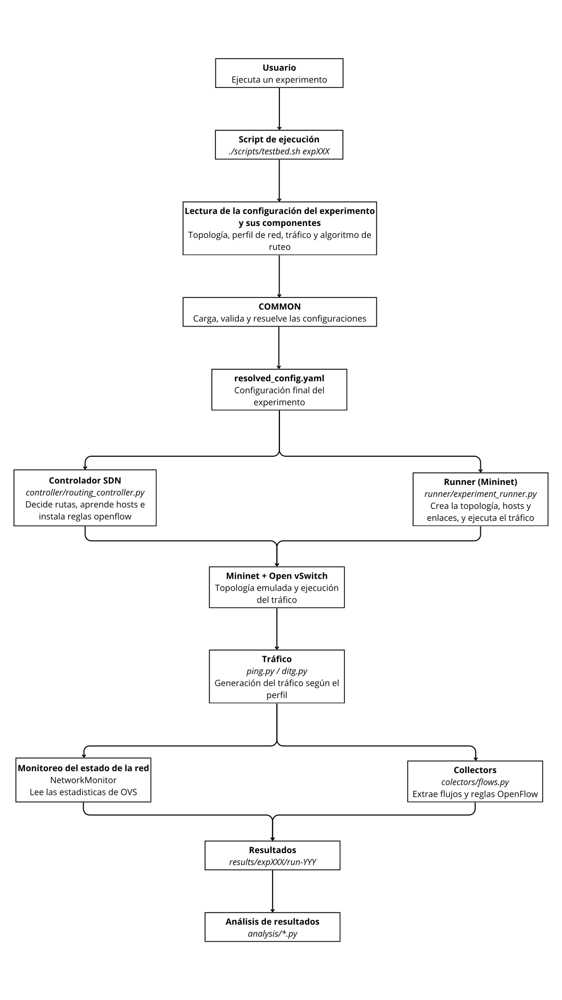

# SDN-IoT Testbed

Banco de pruebas reproducible para evaluar algoritmos de ruteo centralizados en redes SDN-IoT usando Mininet, Open vSwitch, OpenFlow y controladores SDN.

El proyecto permite combinar topologías, perfiles de red, generadores de tráfico y algoritmos de ruteo para ejecutar experimentos comparables y guardar sus resultados.

## Ejecución

Ejecutar un experimento existente:

```bash
./scripts/testbed.sh experiment expXXX
```

Donde XXX es el número del experimento.

Los resultados se guardan en:

```text
results/exp001/run-XXX/
```

Estos incluyen logs, decisiones de ruteo, métricas de red y resultados del tráfico.

## Visualizar un experimento

Los experimentos están definidos en:

```text
experiments/configs/
```

Ejemplo:

```text
experiments/configs/exp008_dijkstra_iinet.yaml
```

Para ejecutarlo:

```bash
./scripts/testbed.sh experiment exp008
```

## Crear un experimento nuevo

Un experimento tiene cuatro componentes principales:

```text
1. Topología
2. Perfil de red
3. Perfil de tráfico
4. Algoritmo de ruteo
```

Para crear uno nuevo, agregar un archivo en:

```text
experiments/configs/
```

Se usa la convención:

```text
experiments/configs/expXXX_nombreAlgoritmoDeRuteo_nombreTopologia_nombreTrafico.yaml
```

Ejemplo:

```text
experiments/configs/exp010_dijkstra_goodnet_ditg.yaml
```

Ese archivo puede reutilizar topologías, perfiles de red, perfiles de tráfico y algoritmos ya existentes.

Ejemplo mínimo:

```yaml
experiment:
  id: exp010
  name: dijkstra-goodnet-ditg

routing:
  name: dijkstra
  module: controller.routing.dijkstra
  class: DijkstraRouting
  metric: routing_cost

topology:
  definition: topologies/definitions/goodnet.yaml
  placement: topologies/placements/goodnet_4_hosts.yaml

network:
  profile: network/profiles/goodnet_equal.yaml

traffic:
  profile: traffic/profiles/ditg_multi.yaml
  generator:
    module: traffic.generators.ditg
    function: run_ditg

collectors:
  - name: flows
    module: collectors.flows
    function: collect_flows
```

Luego ejecutar:

```bash
./scripts/testbed.sh experiment exp010
```

Para más detalle, ver [docs/experiments.md](docs/experiments.md).

## Documentación

La documentación está separada por tema:

- [Arquitectura general](docs/architecture.md)
- [Experimentos](docs/experiments.md)
- [Topologías y Topology Zoo](docs/topologies.md)
- [Perfiles de red](docs/network-profiles.md)
- [Tráfico: ping y D-ITG](docs/traffic.md)
- [Algoritmos de ruteo](docs/routing-algorithms.md)
- [Controladores y versiones](docs/controllers.md)
- [Resultados](docs/results.md)

## Flujo de ejecución

